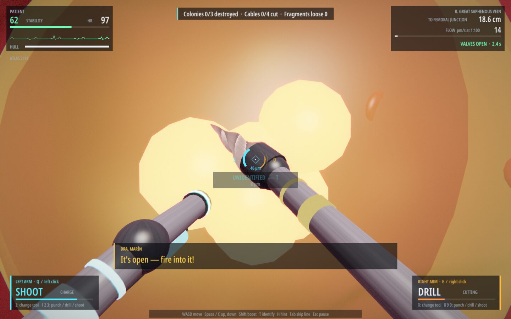
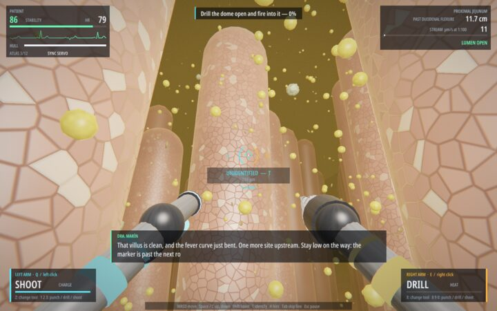
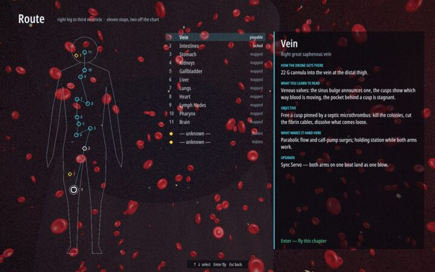
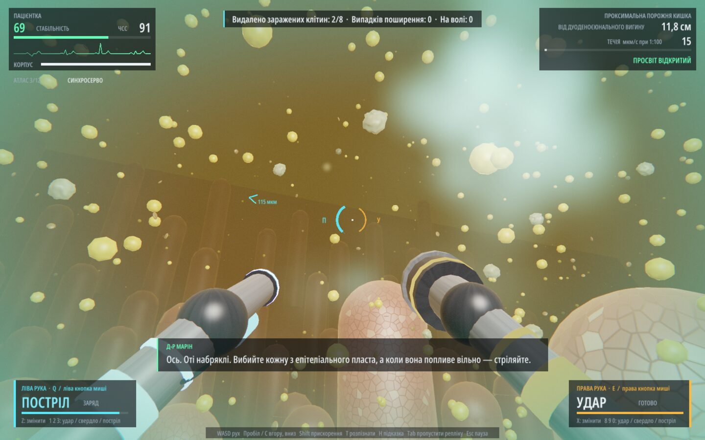

<h1 align="center">Dentro del cuerpo</h1>
<p align="center">A first-person game for macOS, Windows and a Samsung television: pilot a cell-sized drone through a patient's real anatomy, leg vein to brain.</p>
<p align="center">
  <b>Stage:</b> alpha · <b>Target:</b> personal project · <b>License:</b> Apache-2.0 (code), CC BY 4.0 (artwork)
  <br>
  <a href="#installation">Installation</a> · <a href="#controls">Controls</a> · <a href="docs/DESIGN.md">Design</a> · <a href="docs/ARCHITECTURE.md">Architecture</a>
</p>

<p align="center">
  <a href="https://github.com/artmsh/dentro-del-cuerpo/releases/latest"></a>
  <a href="https://github.com/artmsh/dentro-del-cuerpo/releases"></a>
  <a href="https://github.com/artmsh/dentro-del-cuerpo/actions/workflows/ci.yml"></a>
</p>

<p align="center"></p>
<p align="center"><sub>Chapter 1, treating a septic microthrombus: one arm drills the biofilm open, the other fires into it. Rendered offscreen by <code>dentro --shots</code> through the game's Metal pipeline (<a href="docs/images/capture.sh">capture.sh</a>).</sub></p>

> [!WARNING]
> **Alpha.** Chapters 1 to 4 of 11 are playable, about five minutes each; chapters 5 to 11 and the two
> hidden chapters exist only as design and as entries on the route map. A scripted pilot in
> `zig build test` finishes the four playable chapters. The campaign is complete when all eleven chapters
> in [DESIGN.md](docs/DESIGN.md) are playable.

*Inside the Body.* A doctor pilots the drone in through a vein in the patient's right leg and organ by organ
to the brain, treating what it finds on the way. It is playable in English and Ukrainian, on macOS, on
Windows and on a Samsung television. It is written in Zig directly over each system's own interfaces, AppKit
and Metal on macOS, Win32 and Direct3D 11 on Windows, with no engine in between. On the television it draws
with its own OpenGL ES 3.0 backend inside tvengine, the author's runtime for that television, which owns the
window, the pacing of frames to the display, the controllers and the audio stream. The only third-party
code is the vendored `stb_truetype.h`, which rasterises the bundled fonts.

## Rationale

Each chapter is built around one real structure the player has to learn to read before the objective can be
solved: the sinus bulge and cusps of a venous valve, the villi and travelling contraction ring of the
jejunum, the pits of the stomach lining and the pH gradient across its mucus, the renal papilla and the
ducts that open on its tip, and in later chapters the hexagonal liver lobule or the cardiac cycle read from
valve states. The
anatomy, pathogens and dimensions are real (one world unit is one micrometre); the drone, its tools and the
pace are fiction, and the in-game atlas labels which is which.

## Features

- Two independent arms, each with its own key or trigger, tool (Punch, Drill or Shoot), HUD panel, half of
  the reticle, colour and stereo side. A drill stays locked in its cut while its key is held, so the pilot
  can work the other arm on something else.
- Anatomy defined as analytic functions (`src/vein.zig`, `src/gut.zig`, `src/stomach.zig`,
  `src/kidney.zig`) from which the mesh, collision, the flow that carries the drone and the reticle ray casts are all derived.
- Dr. Marín on comms: `T` names what the reticle is on and files it in the atlas, `T` again gives the longer
  explanation, `H` gives three levels of hint per objective.
- Chapter 1, Vein: pulsed parabolic flow, two venous valves to time, a septic microthrombus to treat with
  both arms at once, emboli to dissolve before they reach the lungs, the Sync Servo upgrade and a debrief
  with a grade.
- Chapter 2, Intestines: a chyme stream fast above the villus tips and still between them, peristaltic
  contractions to wait out, a scan that separates rotavirus-infected cells from commensal bacteria, and the
  Mucus Tether upgrade.
- Chapter 3, Stomach: a mucus gel that is neutral at the lining and pH 2 at its top, with the reading on the
  HUD; antral waves that close the lumen and are sat out inside a gastric pit; *Helicobacter pylori* that
  outswims a round in the gel and is hit while it flares; four colonised pits at an ulcer's margin; the
  Buffer Coat upgrade, and a bleeding vessel that one arm presses flat while the other welds it.
- Chapter 4, Kidneys: a minor calyx over a renal papilla whose ducts fire urine in spurts and carry crystals
  that cut the hull; a calcium oxalate stone to drill off the plaque it grew on and then halve four times,
  each time with a notch from one arm's drill and a blow from the other, because a blow with no notch
  throws shards and a piece left too big lodges in the neck of the calyx; and the Resonance upgrade, which
  sends a Sync punch out as a wave that splits every oversized piece ahead.
- Keyboard and mouse, or an Xbox, DualShock 4 or DualSense controller, over USB or Bluetooth with no
  driver or setup. The whole game can be played on the controller alone, menus included, and the two can
  be mixed at any moment. Every prompt on screen names the control of the device used last, in that
  controller's own terms (`A`, `LT`, `Menu` or `✕`, `L2`, `Options`).
- Audio synthesised at runtime, with no sample files; each arm's sounds are panned to its side.
- English and Ukrainian throughout: HUD, menus, route map, briefing, debrief, Dr. Marín's lines, hints and
  the atlas. The language follows the system's preference list on first launch and can be switched with
  `Tab` (`View` on a controller) on the title and pause screens; the choice is saved. A string without a Ukrainian translation fails
  the build or the tests, so the game never falls back to English mid-screen.

<p align="center">
  
  
</p>
<p align="center"><sub>Left: chapter 2, the viroplasm dome that needs drill and shot together. Right: the route map with chapter 1's briefing.</sub></p>

<p align="center"></p>
<p align="center"><sub>Chapter 2 in Ukrainian (<code>dentro --lang uk</code>, or <code>Tab</code> on the title screen).</sub></p>

## Comparison

Compared with [Cell Sword](https://classyk.itch.io/cell-sword) 1.2.2 (Classyk Games, June 2025), the closest
game found: a shooter flown inside the human body.

| | Dentro del cuerpo | [Cell Sword](https://classyk.itch.io/cell-sword) |
|---|---|---|
| Setting | real anatomy and disease (*S. aureus*, rotavirus, *H. pylori*, a kidney stone) | fictional nanobot disease ("Rust") |
| Movement | first person, two independently aimed arms | 6DoF ship, cockpit or third-person view |
| Content | 4 chapters, about 5 minutes each | 12-mission campaign, 5 difficulty levels |
| Platforms | macOS 14+ on Apple Silicon; Windows 10 and 11 on x64; one Samsung television model, built from source; free | Windows, macOS, Linux; $7.99 |
| Input | keyboard and mouse; Xbox and PlayStation controllers; fixed layout | keyboard, mouse, gamepads; remappable |
| Engine | none: Zig on AppKit and Metal, and on Win32 and Direct3D 11; on the television, OpenGL ES inside the author's tvengine | Godot |

Cell Sword is the one to play for a finished campaign, remappable controls, or a Linux machine.

## Requirements

- macOS: an Apple Silicon Mac with macOS 14 or later.
- Windows: 64-bit (x64) Windows 10 or 11 and a graphics card that supports Direct3D 11 at feature level
  11_0, which is any card made since about 2010. Nothing has to be installed: the game uses only DLLs that
  are part of Windows. On a machine with no such card it falls back to WARP, Windows' software renderer,
  which draws the same picture slowly.
- Samsung television: one model, the QE65Q80D (Tizen 9), in developer mode, with an Xbox controller. The
  game is in no store there; it is built from source and installed over the network, which needs Python 3,
  Tizen Studio with the TV extensions (for packaging, `sdb` and the ARM binutils the package checks use)
  and a signing profile for the television.
- Zig 0.17 to build from source. The Windows version cross-compiles from macOS or any other host Zig runs
  on, with no Windows SDK and no Visual Studio.

## Installation

Every push to `main` that passes the tests on both platforms is published as a
[release](https://github.com/artmsh/dentro-del-cuerpo/releases/latest) by [CI](.github/workflows/ci.yml),
with one zip for macOS and one for Windows. The television package is built from source.

### macOS

Download `Dentro-del-cuerpo-macos-arm64.zip` and unzip it. The app is signed ad hoc and not notarised by Apple, so macOS quarantines the download and refuses the first
launch. Clear the quarantine flag once, or approve the app under System Settings → Privacy & Security →
Open Anyway after the first refused launch:

```sh
xattr -dr com.apple.quarantine "Dentro del cuerpo.app"
open "Dentro del cuerpo.app"
```

To build from source instead:

```sh
zig build -Doptimize=ReleaseFast          # builds zig-out/Dentro del cuerpo.app (signed ad hoc)
open "zig-out/Dentro del cuerpo.app"      # or double-click it in Finder
```

`zig build run -- --fullscreen` runs the bare binary, and `zig build --prefix DIR` assembles and signs the
bundle under `DIR` instead of `zig-out`. Cmd+F toggles full screen; Cmd+Q quits, as does the `Quit game`
entry of the title and pause menus. Progress is saved to
`~/Library/Application Support/Dentro del cuerpo/save.txt`.

### Windows

Download `Dentro-del-cuerpo-windows-x64.zip`, unzip it anywhere and run `Dentro del cuerpo.exe` from the
`Dentro del cuerpo` folder. The folder has to stay together, because the game compiles the shader file in
its `shaders` subfolder at startup. The program is not code-signed, so the first launch is usually stopped
by SmartScreen with "Windows protected your PC"; choose **More info** and then **Run anyway**. The zip also
holds a `README.txt` with the controls.

`Alt+Enter` or `F11` toggles full screen (a borderless window on the monitor the game is on). `Alt+F4`
quits, as does the `Quit game` entry of the title and pause menus; full screen and quit are also in the
window's system menu, in the game's language. Progress is saved to `%APPDATA%\Dentro del cuerpo\save.txt`,
in the same format as on macOS. To build from source, on Windows or on any other machine with Zig:

```sh
zig build -Dtarget=x86_64-windows-gnu -Doptimize=ReleaseFast   # builds the folder zig-out/Dentro del cuerpo/
```

### Samsung television

```sh
git submodule update --init                # engine/, the tvengine runtime
tv/build.sh --test --unsigned              # the tests, an unsigned package and the checks of its binary
TV=<address:port> tv/build.sh --install    # signed with the profile CERT_PROFILE (`dev`), installed and launched
```

The game is flown with an Xbox controller connected to the television, with the layout in the table below.
The remote's arrows, OK and Back reach every menu and card, which is enough to start a chapter, change the
language and leave, and it cannot fly the drone; Back on the title screen leaves the game, and in flight it
pauses. The language follows the television's menu language until one is chosen in the game, and progress
is saved in the application's private data directory in the same format as on the other systems. When
another application comes to the front or the television goes to standby the flight pauses and the sound
stops.

The television's GPU cannot shade the scene at 1920×1080 at the display's rate, so the scene is drawn
smaller and scaled up, while the HUD and all text are drawn at full resolution over it. The size follows the
load: the game watches which frames the display showed late or twice, steps the scene down a size when
that happens and tries a size up after a calm stretch. `SCENE_HEIGHT` and `MIN_SCENE_HEIGHT` set the range
at build time (510 and 254 rows by default) and `MSAA` the samples per pixel (4); giving both heights the
same value fixes the size.

### Chapters, saves and language

A chapter unlocks on the route map when the one before it is finished; `--chapter 2`, `--chapter 3` or
`--chapter 4` opens one directly on a desktop. The save
file keeps for each chapter the best grade flown and, among runs of equal grade, the latest. It is replaced
whole on every save, so an interrupted write leaves the previous one, and a save that cannot be written is
reported once on stderr while play goes on. The game starts in Ukrainian if Ukrainian comes before English in the system's list of preferred languages (on
Windows, the display languages under Settings → Time & language), and in English otherwise. `Tab` on the title or pause screen switches the language at once and the choice is
kept in the save file; `--lang en` or `--lang uk` sets it for one run without changing what is saved.

## Controls

| | Keyboard and mouse | Controller |
|---|---|---|
| Move | `W A S D`, `Space` up, `C` down | left stick, `A` up, `B` down |
| Boost | hold `Shift` | click `LS`; it lasts while the stick stays pushed |
| Look | mouse, or arrow keys | right stick |
| Left arm | hold `Q` or left mouse button | hold `LT` |
| Right arm | hold `E` or right mouse button | hold `RT` |
| Left arm tool | `Z` next; `1` Punch, `2` Drill, `3` Shoot | `LB` next, d-pad `←` previous |
| Right arm tool | `X` next; `8` Punch, `9` Drill, `0` Shoot | `RB` next, d-pad `→` previous |
| Identify what the reticle is on; again for the longer explanation. In chapter 2 it is also the scan pulse | `T` (or `F`) | `X` |
| Mucus Tether (chapter 2 upgrade): on tissue within 0.4 mm it attaches and reels in, on nothing it releases | `G` | click `RS`, or d-pad `↑` |
| Buffer Coat (chapter 3 upgrade): nothing to press; it takes the acid in place of the hull for 12 s and refills in neutral gel or blood | | |
| Resonance (chapter 4 upgrade): a Sync punch, with Punch on both arms; it splits stone up to 0.7 mm ahead | `Q` + `E` | `LT` + `RT` |
| Ask Dr. Marín for a hint (three levels per objective) | `H` | `Y` |
| Skip the current comms line | `Tab` | `View` |
| Pause, and resume | `Esc` | `Menu` |
| On the title screen: begin, route map, language, quit game | `↑ ↓` and `Enter`, or `M`, `Tab`, `Cmd+Q` (`Alt+F4` on Windows) | d-pad or left stick and `A`, or `Y`, `View` |
| In the pause menu: resume, relaunch from checkpoint, restart chapter, leave to title, quit game | `↑ ↓` and `Enter`, or `Esc`, `R`, `N`, `L`, `Cmd+Q` (`Alt+F4`) | d-pad or left stick and `A`; `B` resumes |
| Menus and cards: confirm, back | `Enter`, `Esc` | `A`, `B` |
| Switch language (English, Ukrainian) on the title screen or the pause screen | `Tab` | `View`, or d-pad `←` `→` |

The controller column uses Xbox names. On a DualShock 4 or DualSense the same positions are `✕ ○ □ △` for
`A B X Y`, `L1 R1 L2 R2` for `LB RB LT RT`, `L3 R3` for the stick clicks, `Create` (Share on a DualShock 4)
for `View` and `Options` for `Menu`, and the game's prompts use those names when such a controller is the
one in use. The triggers act as buttons, pressed at 40% of their travel and released at 25%. Keyboard, mouse
and controller are read together and their input is added, so the stick can fly while the mouse aims.
Mouse movement alone never changes which device the prompts are written for, since on a handheld the
gyroscope and trackpads arrive as mouse movement. The window's own shortcuts (`Cmd+F` and `Cmd+Q` on macOS,
`Alt+Enter` or `F11` and `Alt+F4` on Windows) have no controller equivalent; a controller quits through the
`Quit game` entry of the title and pause menus. The game pauses itself when its window loses focus and when
the controller in use disconnects during a chapter. Back on a briefing returns to the screen it was opened
from, the title or the route map.

On the television the controller column applies as it stands, with Xbox names in every prompt, and the
remote stands in for the d-pad, `A` and `B` on menus and cards only.

On Windows an Xbox controller, and anything else that presents itself through XInput, is read through
XInput and gets Xbox names. A DualShock 4 or DualSense is read directly from its HID reports over USB or
Bluetooth and gets PlayStation names; when Steam Input or a tool such as DS4Windows presents it as an XInput
controller instead, the game listens to that one and the names are Xbox's.

After the chapter 1 upgrade, triggering both arms within 0.12 s lands them as one Sync Strike. After the
chapter 3 upgrade, a drill held on a vessel that the other arm's punch is pressing flat welds it shut. In
chapter 4 a drill held on a piece of stone cuts a notch, and the other arm's punch on a notched piece splits
it in two.

## Scope

A personal project, built for the author and published as-is. Chapters 5 to 11 are designed in
[DESIGN.md](docs/DESIGN.md): the patient, the route between organs and, for each chapter, the feature to
read, the objective, the challenge and the upgrade. The first hidden chapter's trigger (three cells in the
vein that should not be in circulating blood) is already in chapter 1.

## Limitations

- Apple Silicon Macs, x64 Windows and one television model only: there is no build for Intel Macs, Windows
  on ARM or desktop Linux, and the television package is built for the QE65Q80D and has been run on no
  other model.
- On the television the picture is soft in busy scenes. With the display at 60 Hz the scripted pilot's
  flights of all four chapters held 59 to 60 frames a second with the scene averaging 280 to 300 rows
  over a chapter and at its floor of 254 in the busiest stages, scaled to 1080. Of each 16.7 ms frame about 9 ms goes
  to work whose cost does not depend on the scene's size (the pass that scales to 1080, the HUD, the tone
  mapping and the bloom chain), and only an output surface smaller than 1920×1080, which the engine does
  not offer, would return it. At 50 Hz a frame has 3.3 ms more and the scene should settle larger; that has
  not been measured since the renderer was optimised.
- On the television the game has been flown only by the scripted pilot, with telemetry and captured frames
  read on another machine. A controller in a player's hands, the remote's keys and the writing of the save
  file have not been tried on the device; their code is covered by tests that run on the build machine.
- The Windows version has been run almost entirely on CI machines, which have a desktop session but no
  graphics card, no sound device and no controller. There it passes the same tests as the macOS version,
  its scripted playthroughs print the same summary line for line, and its frames, drawn by Direct3D's
  software renderer, were looked at beside the Metal ones screen by screen in both languages. On one
  physical machine (Windows 11, an NVIDIA card) the scripted playthrough and the offscreen render of every
  screen have been run on the card and on the software renderer. It has not yet been played by hand, so
  frame rate in play, sound output, mouse feel, full screen and behaviour across monitors of different DPI
  are unconfirmed, as is the picture on AMD and Intel cards.
- On Windows the DualShock 4 and DualSense code is tested against the controllers' documented report
  layouts and has not been run against a physical controller.
- The Windows executable is not code-signed, so SmartScreen warns on first launch.
- Under Steam, `Shift+Tab` opens the Steam overlay by default, and the game uses `Shift` for boost and `Tab`
  to skip a comms line, so boosting while skipping a line opens the overlay. The overlay's shortcut can be
  changed in Steam's settings; the game's keys cannot.
- The control layout is fixed: there is no remapping of keys or controller buttons, no sensitivity or
  invert-Y setting for the right stick, and no rumble.
- On macOS, controller hardware coverage is one device: an Xbox Wireless Controller over Bluetooth, on
  which discovery, family detection, every button, both sticks and both triggers were read through the
  game's own reader. No PlayStation controller has been attached, so its family detection and the hand-over
  of the Create and Share button are covered only by the automated tests, which drive a controller object
  that the GameController framework itself provides (see [ARCHITECTURE.md](docs/ARCHITECTURE.md)).
- The mouse-capture warp for a window on a second display follows Apple's documented coordinate spaces and
  is unit-tested as arithmetic, but has not been run on a Mac with two displays.

## Development

```sh
zig build test                 # unit tests, translation checks, a scripted pilot that must finish every playable chapter, and the binary's exit codes
zig-out/bin/dentro --help      # the modes and options
zig-out/bin/dentro --selftest  # the same playthroughs, with a printed summary
zig-out/bin/dentro --shots DIR # offscreen GPU render of every screen and stage, one BMP each
zig-out/bin/dentro --lang uk --shots DIR   # the same in Ukrainian
zig-out/bin/dentro --prompts ps --lang uk --shots DIR   # with the prompts written for kbm, xbox or ps
zig-out/bin/dentro --inputtest # opens the window and drives it with synthetic key events
zig-out/bin/dentro --padtest   # opens the window and plays from the title screen with a synthetic controller
zig-out/bin/dentro --demo      # the scripted pilot flies chapter 1 in the window, with audio
zig-out/bin/dentro --chapter 3 --demo   # or 2, or 4
zig-out/bin/dentro --demo --pad   # the same pilot, holding a controller instead of handing over its controls
tv/build.sh --test --unsigned     # the television package: the tests, the build for ARM and the checks of the binary
DEBUG_HOST=<ip> SELFTEST=1 CHAPTER=2 tv/build.sh --install   # the pilot flies chapter 2 on the television, telemetry to <ip>
```

Every mode exists on Windows with the same flags; the program there is
`zig-out/Dentro del cuerpo/Dentro del cuerpo.exe`, and `--software` makes it render with WARP instead of
the graphics card, which is how CI, having no card, produces its frames. The executable is a GUI program
and opens no console of its own, but started from a terminal the test modes print to it; `cmd.exe` does not
wait for a GUI program unless it is started with `start /wait`, while PowerShell piping its output and Git
Bash do.

```sh
zig build -Dtarget=x86_64-windows-gnu -Doptimize=ReleaseFast   # cross-build the Windows folder from macOS
zig build test                                                 # on Windows as on macOS: the tests, natively
```

The television's renderer can be run on a Mac without the television. `zig build -Dgles` builds the game
with the OpenGL ES backend in place of Metal, drawing offscreen through ANGLE, whose `libEGL` and
`libGLESv2` are looked for in the directory named by `DENTRO_ANGLE_DIR` (any Chromium or Electron
application carries a copy). `--shots` then writes the frames the television would draw, to be compared
with Metal's. A run on the television built with `DEBUG_HOST` sends a line of telemetry every five seconds
to `engine/tools/observe.py` on that machine (presented frame rate, late and repeated frames, the scene's
rows, audio underruns), and with `CAPTURE=1` frames to `engine/tools/capture-server.py`; `tv/build.py`
lists the other build values.

The scripted modes run in English unless `--lang` says otherwise, so their output does not depend on the
machine; `--demo` follows the system like normal play. The tests fail on a string with no Ukrainian text, on
placeholders that differ between the two languages, on any character that has no glyph in the font
atlas, on an action with no controller binding, and on text shown to a controller player that names a key.
`--prompts kbm|xbox|ps` fixes the device the prompts are written for in normal play, `--demo`,
`--inputtest` and `--shots`; without it they follow the device last used.

The command line is checked before anything opens. An option that needs a value and has none, two
different modes, or an option given with a mode in which it would do nothing (`--pad` without `--demo`,
`--chapter` with `--selftest`) prints the reason and the usage and exits with status 2; `--help` and `-h`
print the usage and exit with 0. `--shots` creates its directory if needed and exits with 1 when the
directory cannot be made, a frame cannot be written or a chapter is not flown to its end, so a script can
rely on its status.

```text
Build Summary: 13/13 steps succeeded; 190/190 tests passed
…
selftest ch4: completed=true stage=done sim_time=65.3s deaths=0 stability=98.0 grade=A atlas=4
…
selftest ch3: completed=true stage=done sim_time=106.3s deaths=0 stability=92.8 grade=A atlas=3
…
selftest ch2: completed=true stage=done sim_time=86.8s deaths=0 stability=100.0 grade=A atlas=3
…
selftest: completed=true stage=done sim_time=107.4s deaths=0
  stability=95.5 hull=100 grade=A atlas=3
```

Source layout and build decisions are in [ARCHITECTURE.md](docs/ARCHITECTURE.md).

## License

Source code is licensed under [Apache-2.0](LICENSE). Artwork and writing (the icon in `res/`, the images in
`docs/images/`, the game's script and atlas text, and the design documents in `docs/`) are licensed under
[CC BY 4.0](LICENSE-ARTWORK.txt); attribute them to "Dentro del cuerpo" with a link to this repository.

Third-party files are distributed under their own licences. The fonts are compiled into the binary, and
their licence texts are copied into the app bundle under `Contents/Resources/licenses/`, into the Windows
folder under `licenses` and into the television package under `res/licenses`:

| | | |
|---|---|---|
| `res/fonts/NotoSans-ExtraCondensedMedium.ttf`, `NotoSans-ExtraCondensedSemiBold.ttf` | Noto Sans 2.015, [notofonts/latin-greek-cyrillic](https://github.com/notofonts/latin-greek-cyrillic) | [SIL Open Font License 1.1](res/fonts/OFL-NotoSans.txt) |
| `res/fonts/DejaVuSans.ttf` (arrows and symbols the text face lacks) | DejaVu Sans 2.37, [dejavu-fonts](https://github.com/dejavu-fonts/dejavu-fonts) | [Bitstream Vera and Arev licences, public-domain changes](res/fonts/LICENSE-DejaVu.txt) |
| `vendor/stb/stb_truetype.h` | stb_truetype 1.27, [nothings/stb](https://github.com/nothings/stb) | [MIT or public domain](vendor/stb/LICENSE) |
